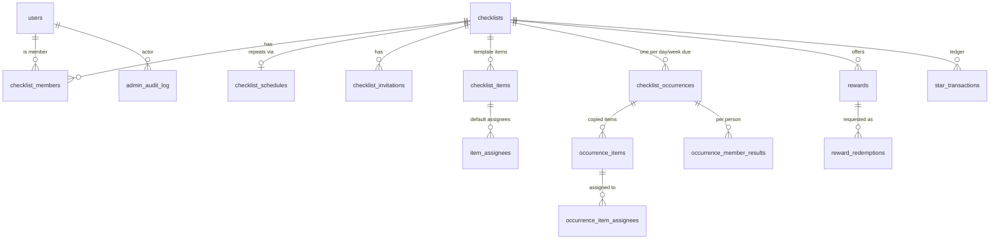

# MyCheckList API

The backend for a shared checklist app. Users sign in with Google through Firebase, create checklists, invite other people to them, and split the items between members.

**Stack:** Kotlin · Spring Boot 4 · PostgreSQL · Flyway · Docker · Kubernetes

**Progress, decisions and next steps:** [docs/PROGRESS.md](docs/PROGRESS.md)

**Status:** Firebase auth, the permission layer and the checklists API are done. The schema now includes repeating lists, stars, streaks and rewards. Their APIs are next, along with members and invitations.

---

## How it works

- **Every list is a template.** Each day (or week, or other period) it's due gets its own **occurrence**: a fresh copy of the items that people tick off. A one-time list has exactly one occurrence.
- **Repeating lists** can be daily, weekly, monthly, every N days/weeks/months, on chosen weekdays (e.g. Mon, Wed, Sat), monthly on a date or on the "last Friday", and can end on a date or after N times.
- A "day" ends at **midnight in the list's time zone**. Then the occurrence closes and items from that day can't be ticked any more. Template edits apply from the next occurrence.
- **Stars (repeating lists only):** you earn them the moment every item assigned to you that day is done. If someone helps by ticking your item, it still counts. Streak tiers raise the reward (1★ up to 4★), and a **team bonus** (+1★ to +3★) is added when everyone finishes. Results are settled at midnight.
- **Rewards:** owners and editors create rewards (title, description, star cost). Members request one, their stars are held, and another owner or editor approves or rejects it.

Full rules, tiers and examples: [docs/PROGRESS.md](docs/PROGRESS.md#stars-and-rewards).

## Data model



| Table | Purpose |
|---|---|
| `users` | One row per person, created on first sign-in. `platform_role` is `USER` or `SUPER_ADMIN`. |
| `checklists` | A list: `time_zone`, team streak, `archived_at` (soft delete). |
| `checklist_schedules` | The repeat rule. No row = a one-time list. |
| `checklist_members` | `OWNER` (exactly one), `EDITOR`, `VIEWER`, plus cached star balance and streaks. |
| `checklist_invitations` | Invite inbox, matched by email. `PENDING → ACCEPTED / DECLINED / REVOKED / EXPIRED`. |
| `checklist_items`, `item_assignees` | The template: items in order, and their default assignees. |
| `checklist_occurrences` | One per date the list is due. `OPEN` until midnight, then `CLOSED`. |
| `occurrence_items`, `occurrence_item_assignees` | That day's copy of the items; `completed_at/by` record who ticked each one. |
| `occurrence_member_results` | Per person per occurrence: items assigned and done, stars awarded, streak. |
| `rewards`, `reward_redemptions` | Rewards and requests to redeem them (`PENDING → APPROVED / REJECTED / CANCELLED`). |
| `star_transactions` | The star ledger: every star earned, spent, refunded or adjusted. |
| `admin_audit_log` | Changes a super admin made to other people's data. |

**Permissions**

| | Owner | Editor | Viewer | Super admin |
|---|:-:|:-:|:-:|:-:|
| View list, items, history, rewards | ✓ | ✓ | ✓ | ✓ (any list) |
| Tick items, request rewards | ✓ | ✓ | | ✓ |
| Edit items, schedule, assignees | ✓ | ✓ | | ✓ |
| Invite people | ✓ | ✓ (viewers only) | | ✓ |
| Create, edit and remove rewards; approve redemptions; adjust stars | ✓ | ✓ | | ✓ |
| Change roles, remove members, archive or delete the list | ✓ | | | ✓ |

**Completion:** the first tick completes an item for everyone (`... WHERE completed_at IS NULL`), so when two people tap at the same moment, exactly one wins.

The schema lives in [`src/main/resources/db/migration`](src/main/resources/db/migration). Once a migration has run against a database you keep, **never edit it**; add a new `V2__description.sql` instead. (V1 was rewritten on 2026-10-15, before any real database existed.) To wipe local data: `docker compose down -v`.

---

## One-time setup (macOS)

1. **Docker Desktop:** install it, then go to *Settings → Kubernetes → Enable Kubernetes*.
2. **JDK 21** (only needed to run the app outside Docker, e.g. from IntelliJ). Android Studio's bundled JBR 21 works, or you can run `brew install --cask temurin@21`.
3. **Firebase:** the project is `mychecklist-e745d`, and it's already the default in config. In the [Firebase console](https://console.firebase.google.com), enable *Authentication → Sign-in method → Google*. To use another project, set `FIREBASE_PROJECT_ID` to its **Project ID** (from *Project settings*), not its project number or display name.

The server doesn't need a Firebase service account. It checks each Firebase ID token against Google's public keys.

## Run locally: option A (fastest for development)

```bash
docker compose up -d db                       # start Postgres
export APP_SUPER_ADMIN_EMAILS=you@gmail.com   # optional: makes you super admin
./gradlew bootRun                             # or run MyChecklistApplication in IntelliJ
```

## Run locally: option B (everything in Docker)

```bash
APP_SUPER_ADMIN_EMAILS=you@gmail.com docker compose up --build
```

## Run locally: option C (Kubernetes, Docker Desktop)

```bash
# 1. Edit k8s/api.yaml → set APP_SUPER_ADMIN_EMAILS
docker build -t mychecklist-api:dev .
kubectl apply -k k8s/
kubectl -n mychecklist get pods -w            # wait for api to be Running 1/1
curl http://localhost:30080/actuator/health
```

After you change the code: `docker build -t mychecklist-api:dev . && kubectl -n mychecklist rollout restart deployment/api`
To tear it all down: `kubectl delete -k k8s/`

## Run the tests

```bash
./gradlew test     # needs Docker running; Testcontainers starts a temporary Postgres
```

The report is at `build/reports/tests/test/index.html`. API tests use fake tokens (`jwt()`), so no real Firebase account is needed.

## Try the API

Get an ID token in your app with `Firebase.auth.currentUser?.getIdToken(false)`, then:

```bash
TOKEN=eyJhbGci...
curl -H "Authorization: Bearer $TOKEN" http://localhost:8080/api/me
curl -H "Authorization: Bearer $TOKEN" http://localhost:8080/api/admin/users   # super admin only
```

| Endpoint | Auth | Notes |
|---|---|---|
| `GET /actuator/health` | public | Kubernetes probes use `/liveness` and `/readiness` |
| `GET /api/me` | any user | Creates your user row on first call |
| `GET /api/admin/users` | super admin | |
| `POST /api/checklists` | any user | Creates a list; you become OWNER. Body: `title`, `description?`, `timeZone?` (IANA, e.g. `America/Vancouver`; default `UTC`) |
| `GET /api/checklists[?archived=true]` | any user | Lists you're a member of |
| `GET /api/checklists/{id}` | viewer+ | |
| `PATCH /api/checklists/{id}` | editor+ | `title`, `description`, `timeZone` |
| `POST /api/checklists/{id}/archive` · `/unarchive` | owner | Archived lists are read-only |
| `DELETE /api/checklists/{id}?confirm=true` | owner | Permanent |

Errors come back as [RFC 7807](https://www.rfc-editor.org/rfc/rfc7807) JSON (`status`, `title`, `detail`). If you aren't a member of a list, you get **404**, the same as for a list that doesn't exist. If your role is too low, you get **403**.

## Code layout

```
src/main/kotlin/com/mychecklist/
├── common/     ApiExceptions, ApiExceptionHandler (RFC 7807 errors)
├── config/     SecurityConfig (Firebase JWT), AppProperties
├── user/       User entity, UserService (token → user row), @CurrentUser, /api/me
├── checklist/  lists, members, schedules, occurrences, ChecklistAccessService (permissions), checklists API
├── stars/      star ledger, rewards, redemptions
└── admin/      audit log, /api/admin
```

**Rule for new endpoints:** take `@CurrentUser user: User`. Anything that touches a checklist must call `ChecklistAccessService.requireAccess(checklistId, user, minimumRole)` first, then `auditIfAdmin(...)` after a write. Never build SQL by joining strings.

## Super admin

Super admin status is controlled by the `APP_SUPER_ADMIN_EMAILS` setting, a comma-separated list. On every sign-in, a user whose **verified** email is on that list becomes `SUPER_ADMIN`, and everyone else becomes `USER`. Nobody can grant the role through the API.

To edit the database directly, connect any Postgres client (TablePlus, DBeaver, IntelliJ's Database tool) to `localhost:5432`, database, user and password all set to `mychecklist`. On Kubernetes, first run `kubectl -n mychecklist port-forward svc/postgres 5432:5432`.

## Going online later (free-tier ideas)

- **Database:** create a [Neon](https://neon.tech) project and set `DB_URL=jdbc:postgresql://<host>/<db>?sslmode=require`, plus `DB_USERNAME` and `DB_PASSWORD`. Flyway creates the tables on first start.
- **App:** this repo builds a standard Docker image, so it can run on any container host. Cloudflare doesn't offer Kubernetes. For Kubernetes online, a common free option is k3s on Oracle Cloud's free tier.
