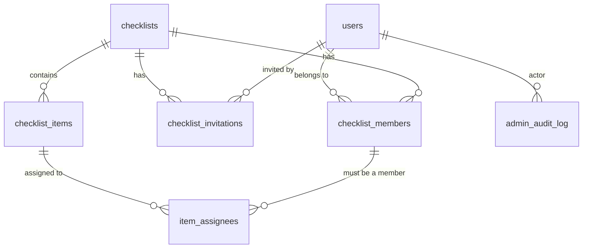

# MyCheckList API

The backend for a shared checklist app. Users sign in with Google through Firebase, create checklists, invite other people to them, and split the items between members.

**Stack:** Kotlin · Spring Boot 4 · PostgreSQL · Flyway · Docker · Kubernetes

**Progress, decisions and next steps:** [docs/PROGRESS.md](docs/PROGRESS.md)

---

## Data model



| Table | Purpose |
|---|---|
| `users` | One row per person, created on first sign-in. `platform_role` is `USER` or `SUPER_ADMIN`. |
| `checklists` | A list. `archived_at` set = archived (soft delete). |
| `checklist_members` | Who is in a list: `OWNER` (exactly one), `EDITOR`, `VIEWER`. |
| `checklist_invitations` | Invite inbox, matched by email. `PENDING → ACCEPTED / DECLINED / REVOKED / EXPIRED`. |
| `checklist_items` | Items with `position` for ordering. `completed_at/by` = who checked it off. |
| `item_assignees` | 0..n assignees per item. The DB guarantees assignees are members of the list. |
| `admin_audit_log` | Records changes a super admin makes to other people's data. |

**Permissions**

| | Owner | Editor | Viewer | Super admin |
|---|:-:|:-:|:-:|:-:|
| View list & items | ✓ | ✓ | ✓ | ✓ (any list) |
| Add / edit / assign / complete items | ✓ | ✓ | | ✓ |
| Invite people | ✓ | ✓ | | ✓ |
| Change roles, remove members, delete list | ✓ | | | ✓ |

**Completion (V1):** every item uses `ANY` mode, so the first assignee to check an item off completes it for everyone. The update only succeeds while the item is still open (`... WHERE completed_at IS NULL`), so when two people tap at the same moment, exactly one of them wins.

The schema lives in [`src/main/resources/db/migration`](src/main/resources/db/migration). **Never edit a migration that has already run.** Add a new `V2__description.sql` file instead.

---

## One-time setup (macOS)

1. **Docker Desktop:** install it, then go to *Settings → Kubernetes → Enable Kubernetes*.
2. **JDK 21** (only needed to run the app outside Docker, e.g. from IntelliJ). Android Studio's bundled JBR 21 works, or you can run `brew install --cask temurin@21`.
3. **Firebase:** (project `mychecklist-e745d` is already the default in config) in the [Firebase console](https://console.firebase.google.com), create a project and enable *Authentication → Sign-in method → Google*. Then copy the **Project ID** from *Project settings*.

The server doesn't need a Firebase service account. It checks each Firebase ID token against Google's public keys.

## Run locally: option A (fastest for development)

```bash
docker compose up -d db                       # start Postgres
export FIREBASE_PROJECT_ID=your-project-id
export APP_SUPER_ADMIN_EMAILS=you@gmail.com
./gradlew bootRun                             # or run MyChecklistApplication in IntelliJ
```

## Run locally: option B (everything in Docker)

```bash
FIREBASE_PROJECT_ID=your-project-id APP_SUPER_ADMIN_EMAILS=you@gmail.com docker compose up --build
```

## Run locally: option C (Kubernetes, Docker Desktop)

```bash
# 1. Edit k8s/api.yaml → set FIREBASE_PROJECT_ID and APP_SUPER_ADMIN_EMAILS
docker build -t mychecklist-api:dev .
kubectl apply -k k8s/
kubectl -n mychecklist get pods -w            # wait for api to be Running 1/1
curl http://localhost:30080/actuator/health
```

After you change the code: `docker build -t mychecklist-api:dev . && kubectl -n mychecklist rollout restart deployment/api`
To tear it all down: `kubectl delete -k k8s/`

## Run the tests

```bash
./gradlew test     # needs Docker running; Testcontainers starts a temporary Postgres
```

## Try the API

Get an ID token in your app with `Firebase.auth.currentUser?.getIdToken(false)`, then:

```bash
TOKEN=eyJhbGci...
curl -H "Authorization: Bearer $TOKEN" http://localhost:8080/api/me
curl -H "Authorization: Bearer $TOKEN" http://localhost:8080/api/admin/users   # super admin only
```

| Endpoint | Auth | Notes |
|---|---|---|
| `GET /actuator/health` | public | Kubernetes probes use `/liveness` and `/readiness` |
| `GET /api/me` | any user | Creates your user row on first call |
| `GET /api/admin/users` | super admin | |
| `POST /api/checklists` | any user | Creates a list; you become OWNER |
| `GET /api/checklists[?archived=true]` | any user | Lists you're a member of |
| `GET /api/checklists/{id}` | viewer+ | |
| `PATCH /api/checklists/{id}` | editor+ | `title`, `description` |
| `POST /api/checklists/{id}/archive` · `/unarchive` | owner | Archived lists are read-only |
| `DELETE /api/checklists/{id}?confirm=true` | owner | Permanent |

Errors come back as [RFC 7807](https://www.rfc-editor.org/rfc/rfc7807) JSON (`status`, `title`, `detail`). If you aren't a member of a list, you get **404**, the same as for a list that doesn't exist. If your role is too low, you get **403**.

## Super admin

Super admin status is controlled by the `APP_SUPER_ADMIN_EMAILS` setting, a comma-separated list. On every sign-in, a user whose **verified** email is on that list becomes `SUPER_ADMIN`, and everyone else becomes `USER`. Nobody can grant the role through the API.

To edit the database directly, connect any Postgres client (TablePlus, DBeaver, IntelliJ's Database tool) to `localhost:5432`, database, user and password all set to `mychecklist`. On Kubernetes, first run `kubectl -n mychecklist port-forward svc/postgres 5432:5432`.

## Going online later (free-tier ideas)

- **Database:** create a [Neon](https://neon.tech) project and set `DB_URL=jdbc:postgresql://<host>/<db>?sslmode=require`, plus `DB_USERNAME` and `DB_PASSWORD`. Flyway creates the tables on first start.
- **App:** this repo builds a standard Docker image, so it can run on any container host. Cloudflare doesn't offer Kubernetes. For Kubernetes online, a common free option is k3s on Oracle Cloud's free tier.
