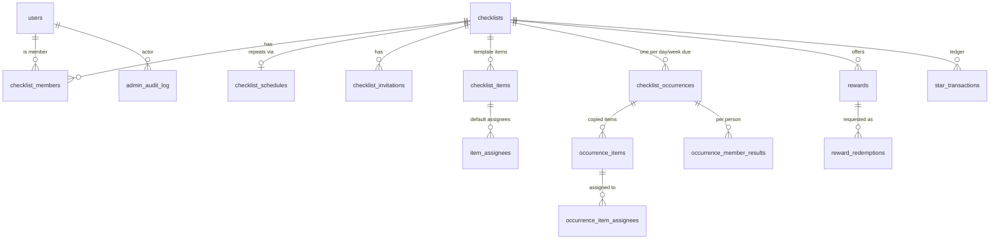

# MyCheckList Backend — Progress Log

> **This file is the main record of project progress.** Update it at the end of every work session: the status, the roadmap checkboxes and the session log.
> Shareable view (may lag behind this file): [Claude Doc](https://claude.ai/code/artifact/723d9711-56f2-47bb-8819-1605d8fa82c1)

Last updated: 2026-10-15

## Status

The database now supports **repeating lists, stars, streaks and rewards**. The schema is done, and the entities match it. The APIs for these features haven't been built yet.

`./gradlew test` passed 14 of 14 tests before this change. **The new schema needs a fresh `./gradlew test` run on Jian's Mac** (expect 16 tests).

- **Repo:** [github.com/munl/MyCheckList](https://github.com/munl/MyCheckList), branch `main`
- **Firebase project ID:** `mychecklist-e745d` (the default in config)
- **Done:** database schema (including schedules, occurrences, stars and rewards), Firebase sign-in, user records, the super admin role, Docker and Kubernetes setup, the authorization layer, the checklists API
- **Next:** run the tests, then the Members and Invitations API, then the Items and Occurrences API (which includes earning stars)

### Pick up here

1. Run `./gradlew test`, fix anything that fails, then commit and push.
2. Build the **Members API**: list members, change role (EDITOR ⇄ VIEWER), remove a member, leave a list, transfer ownership. The owner can't be removed or demoted directly.
3. Build the **Invitations API**: invite by email (EDITOR+, and only the OWNER can invite editors), the inbox at `/api/me/invitations`, accept or decline, revoke, expiry. Responses must not reveal whether an email has an account.
4. Build the **Schedule, Items and Occurrences API**. See [Repeating lists](#repeating-lists) and [Stars and rewards](#stars-and-rewards) below for the rules.
5. Every endpoint goes through `ChecklistAccessService.requireAccess`, with tests for outsiders (404) and roles that are too low (403).
6. In parallel: finish Firebase Google sign-in and call `GET /api/me` with a real token from the Android app.

### About the database and migrations

No real database has been created yet. `./gradlew test` uses a temporary Postgres that Testcontainers deletes after each run. That's why the new tables were written straight into `V1__initial_schema.sql` instead of a `V2` migration.

**From the first time the app runs against a database we keep** (local `docker compose`, Kubernetes or Neon), V1 is frozen and every change goes in `V2__…`, `V3__…`. To wipe a local database and start fresh: `docker compose down -v` (the `-v` deletes the data volume), or `kubectl delete -k k8s/` for Kubernetes.

## Decisions made

| Topic | Decision | Why |
| --- | --- | --- |
| Stack | Kotlin 2.2, Spring Boot 4.0.8, Java 21, Gradle 8.14 | Spring Boot 3.5 is past end of life; Kotlin matches Jian's Android background |
| Architecture | A modular monolith: one Spring Boot app and one database, with code grouped by feature (`user/`, `checklist/`, `stars/`, `admin/`) | The data is tightly linked, so splitting it into services gains nothing at this scale. To scale, add replicas. A notifications worker is the first candidate to split out later |
| Database | PostgreSQL, with the schema managed by Flyway migrations | Versioned SQL files; the app refuses to start if the code and tables disagree |
| Auth | Firebase Google sign-in; the server checks the ID token against Google's public keys | No service account file needed |
| Permissions | All checklist access goes through `ChecklistAccessService.requireAccess(...)`. Non-member: 404. Role too low: 403. Archived list: 409 on writes | One place to get right; IDs can't be probed |
| Errors | RFC 7807 `ProblemDetail` JSON. No stack traces, SQL or exception messages | Consistent for clients; doesn't leak internals |
| Hosting now | Local only: Docker Compose, or Kubernetes through Docker Desktop | Free, good for learning |
| Hosting later | Neon for Postgres; the app on a container host (Cloudflare Containers), or k3s on Oracle's free tier for Kubernetes online | Cloudflare doesn't run Kubernetes |
| List roles | Owner (one per list), Editor, Viewer | |
| Super admin | `users.platform_role = SUPER_ADMIN`, set from the `APP_SUPER_ADMIN_EMAILS` setting; requires a verified email; changes go to `admin_audit_log` | The role can't be granted through the API |
| Invites | By email, into an in-app inbox to accept or decline; real emails are optional and later | So invites don't depend entirely on email |
| Assignment | Zero, one or many assignees per item; a list can be filtered by person | Works for both single-owner and shared tasks |
| Completion | "First one wins": the first tick completes the item for everyone. **Helping counts**, so if someone else ticks your item, it counts for you | Encourages helping each other |
| Repeating lists | Every list is a **template**; each day or week it's due gets its own **occurrence** (a fresh copy). A one-time list has exactly one occurrence | One model for both kinds of list, with full history |
| Repeat options | Daily, weekly, monthly, every N days/weeks/months, chosen weekdays (e.g. Mon, Wed, Sat), monthly on a date or on the "Nth/last weekday"; can end on a date or after N times | Covers the custom options asked for |
| Day boundary | Midnight in the **list's own time zone** (set by the owner, defaulting to their phone's zone) | Everyone on a list shares one "today" |
| Template edits | Apply from the **next** occurrence; today's copy doesn't change | Stops anyone removing undone items to fake completion |
| Past days | **Closed at midnight.** Items from previous days can't be ticked | Streaks can't be patched later |
| Stars | Only on **repeating** lists. You earn them when **all items assigned to you** in an occurrence are done | Fair when work is split |
| No items that day | The day is **skipped**: no star, and the streak isn't broken | |
| Star timing | Awarded **instantly** when your last item is ticked. Taken back if an item is unticked before midnight. **Settled at midnight** | Instant reward feeling, and the final result is correct |
| Compounding | Streak tiers with a cap, for you and for the team (table below). Tiers live in config so they can be tuned | |
| Team bonus | When **everyone** with items finishes, each of them gets a bonus that grows with the team streak and has a cap | Rewards working together |
| Non-daily lists | One star "unit" per occurrence (a weekly list counts streaks in weeks) | |
| Rewards | Per list. Owners **and editors** create, edit and remove them, and can change the star cost at any time. Redemptions are unlimited | |
| Redeeming | A member requests it, stars are **held** straight away, and an owner or editor approves (stars spent) or rejects (stars refunded). **You can't approve your own request** unless you're the only owner or editor | Prevents spending the same stars twice, and self-approval |
| Adjustments | Owners and editors can add or remove stars by hand, **with a reason**; every change is in the star ledger | Balances can always be explained |

## Data model

There are 15 tables. The database enforces the key rules itself, so a bug in the API can't break them. All IDs are UUIDs and all timestamps are `timestamptz`. The SQL is in `src/main/resources/db/migration/V1__initial_schema.sql`.



| Table | Purpose |
| --- | --- |
| `users` | One row per person, created on first sign-in. `platform_role` is `USER` or `SUPER_ADMIN` |
| `checklists` | A list. `time_zone`, team streak, `archived_at` (soft delete) |
| `checklist_schedules` | How a list repeats. **No row = a one-time list** |
| `checklist_members` | Who's in a list, their role, plus cached `star_balance`, `current_streak`, `longest_streak` |
| `checklist_invitations` | The invite inbox, matched by email |
| `checklist_items`, `item_assignees` | The **template**: items and their default assignees |
| `checklist_occurrences` | One per date the list is due: `occurrence_date`, `due_at`, `status` (`OPEN`/`CLOSED`) |
| `occurrence_items`, `occurrence_item_assignees` | That occurrence's copy of the items; ticking happens here |
| `occurrence_member_results` | How each person did: items assigned and done, stars awarded, streak after |
| `rewards` | Title, description, star cost, active flag, soft delete |
| `reward_redemptions` | Requests to spend stars: `PENDING` → `APPROVED` / `REJECTED` / `CANCELLED`. The cost is copied at request time |
| `star_transactions` | **The ledger**: every star earned, spent, refunded or adjusted |
| `admin_audit_log` | Changes a super admin made to other people's data |

| Rule | How it's enforced |
| --- | --- |
| One owner per list | Partial unique index on `checklist_members` where `role = 'OWNER'` |
| No duplicate pending invites | Partial unique index on (`checklist_id`, `invitee_email`) where `status = 'PENDING'` |
| Assignees must be list members | Composite foreign keys from both assignee tables to `checklist_members`; removing a member unassigns them |
| One occurrence per list per date | Unique (`checklist_id`, `occurrence_date`) |
| Schedules are valid | CHECKs: weekly needs at least one weekday; monthly uses a date **or** an "Nth weekday", never both; `ends_on` ≥ `starts_on` |
| First person to complete an item wins | `UPDATE … WHERE completed_at IS NULL`; exactly one caller gets 1 row updated |
| No silent overwrites | `version` column on occurrence items (JPA `@Version`) |
| Stars awarded at most once per person per occurrence | Partial unique index on `star_transactions` (occurrence, user, type) for rows that aren't voided |
| A redemption is charged once and refunded at most once | Unique (`redemption_id`, `type`) |
| Balances never go negative | `CHECK (star_balance >= 0)` |
| Adjustments have a reason and an author | CHECK on `star_transactions` |
| Reward costs are 1–100,000 stars | CHECK |
| `updated_at` stays correct, even for edits made directly in SQL | Database triggers |

## Repeating lists

`checklist_schedules` stores a subset of the calendar-standard repeat rule (RFC 5545):

| Example | `frequency` | Other fields |
| --- | --- | --- |
| Every day | `DAILY` | `repeat_interval = 1` |
| Every 3 days | `DAILY` | `repeat_interval = 3` |
| Mon, Wed, Sat | `WEEKLY` | `weekday_mask = 37` (Mon 1 + Wed 4 + Sat 32) |
| Every other Friday | `WEEKLY` | `repeat_interval = 2`, `weekday_mask = 16` |
| 15th of each month | `MONTHLY` | `month_day = 15` |
| Last Friday of the month | `MONTHLY` | `month_week = -1`, `month_weekday = 5` |
| …for 12 times / until a date | any | `max_occurrences = 12` / `ends_on` |

The weekday bits are Mon=1, Tue=2, Wed=4, Thu=8, Fri=16, Sat=32, Sun=64. In Kotlin, use `ChecklistSchedule.maskOf(MONDAY, WEDNESDAY, SATURDAY)`.

**Lifecycle of an occurrence**

1. **Created** when someone first opens the list on a due day, or by a scheduled job just after midnight in the list's time zone. Items and assignees are copied from the template.
2. **Open:** items are ticked. Stars are awarded instantly when a person's last item is done, and voided if an item is unticked.
3. **Closed** at `due_at` (the next midnight in the list's zone) by a scheduled job, which settles the results:
   - Each person who finished: their streak goes up by 1.
   - Each person with items who didn't finish: their streak resets to 0.
   - People with no items: no change.
   - Team streak: +1 if everyone with items finished, otherwise reset to 0.
4. Closed occurrences are read-only history.

## Stars and rewards

**Stars per occurrence** (tiers kept in config so they can be tuned):

| Streak (consecutive completed occurrences, including this one) | Your stars | Team bonus (each member who had items) |
| --- | --- | --- |
| 1–6 | 1★ | +1★ |
| 7–13 | 2★ | +2★ |
| 14–29 | 3★ | +3★ (cap) |
| 30+ | 4★ (cap) | +3★ |

The most anyone can earn per occurrence is 7★. Example: on day 10 of your streak and day 8 of the team's, you get 2★ + 2★ = 4★.

**Balance:** the ledger (`star_transactions`) is the source of truth. `checklist_members.star_balance` is a cached sum, updated in the same transaction as each ledger row.

| Ledger `type` | `amount` | When |
| --- | --- | --- |
| `DAILY_COMPLETION` | +1 to +4 | Your last item is done. Voided if an item is unticked before midnight |
| `TEAM_BONUS` | +1 to +3 | The whole team finished |
| `ADJUSTMENT` | ± | An owner or editor adds or removes stars, with a reason |
| `REDEMPTION` | − cost | A reward is requested (the stars are held) |
| `REDEMPTION_REFUND` | + cost | The request is rejected or cancelled |

**Redemption flow:** request (needs `star_balance` ≥ cost; stars are held) → an owner or editor who isn't the requester approves (stays spent) or rejects (refunded). The requester can cancel while it's pending (refunded). If there's only one owner or editor on the list, they can approve their own request.

## What's in the repo

The source code is under `src/main/kotlin/com/mychecklist/`.

| Path | What it does |
| --- | --- |
| `build.gradle.kts`, `settings.gradle.kts`, `gradlew` | Build setup: dependencies, the Kotlin and Spring plugins, the Java 21 toolchain |
| `resources/application.yml` | Settings: database URL, Firebase token checks, health endpoints. Each can be overridden with an env var |
| `resources/db/migration/V1__initial_schema.sql` | All 15 tables, constraints, indexes and `updated_at` triggers |
| `config/SecurityConfig.kt` | Every `/api/**` request needs a Firebase token; health checks are public; no server-side sessions |
| `config/AppProperties.kt` | Reads `app.firebase-project-id` and `app.super-admin-emails` |
| `common/ApiExceptions.kt`, `ApiExceptionHandler.kt` | `NotFound` / `Forbidden` / `Conflict` / `BadRequest` exceptions, turned into problem JSON |
| `user/` | `User` entity, `UserService` (token → user row), `@CurrentUser`, `GET /api/me` |
| `checklist/ChecklistEntities.kt` | Checklists, members (with star and streak totals), invitations, template items and assignees |
| `checklist/ScheduleEntities.kt` | Schedules, occurrences, occurrence items and assignees, member results |
| `checklist/ChecklistRepositories.kt` | Database queries, including `OccurrenceItemRepository.completeIfOpen` (first one wins) |
| `checklist/ChecklistAccessService.kt` | **The permission check.** Every checklist, member, invite, item and reward operation must call `requireAccess` |
| `checklist/ChecklistService.kt`, `ChecklistController.kt`, `ChecklistDtos.kt` | The checklists API |
| `stars/StarEntities.kt`, `StarRepositories.kt` | The star ledger, rewards, redemptions |
| `admin/` | `AdminAuditService` (audit rows), `GET /api/admin/users` |
| `src/test/.../SchemaAndUserSyncTest.kt` | Schema, user sync, "first one wins" with a helper, schedule weekdays, award-once tests |
| `src/test/.../ChecklistApiTest.kt` | API tests: each role, super admin, archived lists, validation, time zones, 401 |
| `Dockerfile`, `docker-compose.yml`, `k8s/` | Container image, local Postgres 17, Kubernetes manifests |
| `scripts/create-github-issues.sh` | Creates the V1 backlog as GitHub issues (`gh` CLI). Tickets are on hold for now |

**Endpoints so far**

| Endpoint | Who can call it |
| --- | --- |
| `GET /actuator/health` (plus `/liveness` and `/readiness`) | Anyone |
| `GET /api/me` | Any signed-in user; the first call creates their user row |
| `GET /api/admin/users` | Super admin only |
| `POST /api/checklists` | Any signed-in user (they become OWNER). Body: `title`, `description?`, `timeZone?` |
| `GET /api/checklists` (`?archived=true`) | Any user; returns only lists they're a member of |
| `GET /api/checklists/{id}` | VIEWER or higher |
| `PATCH /api/checklists/{id}` | EDITOR or higher (`title`, `description`, `timeZone`) |
| `POST /api/checklists/{id}/archive` and `/unarchive` | OWNER |
| `DELETE /api/checklists/{id}?confirm=true` | OWNER |

## How to run it

Docker Desktop must be running for all of these. Kubernetes is only needed for the last one.

```bash
# Tests (Testcontainers starts a throwaway Postgres, then deletes it)
./gradlew test

# Day-to-day development
docker compose up -d db
export APP_SUPER_ADMIN_EMAILS=you@gmail.com   # optional
./gradlew bootRun

# Everything in Docker
docker compose up --build

# Kubernetes (Docker Desktop > Settings > Kubernetes > Enable). Set APP_SUPER_ADMIN_EMAILS in k8s/api.yaml first
docker build -t mychecklist-api:dev .
kubectl apply -k k8s/
curl http://localhost:30080/actuator/health

# Wipe local data and start fresh
docker compose down -v        # or: kubectl delete -k k8s/
```

To call the API, get an ID token in the app with `Firebase.auth.currentUser?.getIdToken(false)`, then send it as `Authorization: Bearer <token>`.

## Roadmap

- [x] Plan the data model and roles
- [x] Scaffold the project: schema, auth, Docker, Kubernetes, tests
- [x] Push to GitHub
- [x] **Authorization layer:** `ChecklistAccessService`, `@CurrentUser`, problem-detail errors, validation, admin audit
- [x] **Checklists API:** create, list mine, get, rename, archive, unarchive, delete (14 tests passed)
- [x] **Schema for repeating lists, stars and rewards** (schedules, occurrences, results, ledger, rewards, redemptions) and its entities
- [ ] Run `./gradlew test` on the new schema (expect 16 tests)
- [ ] Set up Firebase Google sign-in and test `/api/me` with a real token (in progress)
- [ ] **Members API:** list, change role, remove, leave, transfer ownership
- [ ] **Invitations API:** invite by email, inbox, accept or decline, revoke
- [ ] **Schedule API:** set, change or remove a list's repeat rule, and preview its next dates
- [ ] **Items and Occurrences API:** template items (add, edit, reorder, assign); today's occurrence (get or create, tick and untick, "my items" and "unassigned" filters); history
- [ ] **Stars engine:** instant awards and voids, streak and team-bonus tiers from config, a midnight job that closes occurrences and settles streaks
- [ ] **Rewards API:** create, edit, change cost, deactivate, delete; request, approve, reject, cancel redemptions; manual adjustments; star history
- [ ] **Admin API:** edit or delete anything, with every change written to the audit log
- [ ] CI (GitHub Actions) and Dependabot
- [ ] API docs (OpenAPI/Swagger) for the mobile client
- [ ] Security hardening, then deploy online: Neon plus a container host

**Open questions**

- Should invites send a real email in V1, or only show up in the in-app inbox?
- Should star tiers be configurable per list by the owner, or only globally in config?
- Notifications: push "your streak is at risk" reminders (needs Firebase Cloud Messaging)?
- Later: should items support an `EACH` completion mode, where every assignee ticks their own copy?
- Later: real-time updates (WebSockets or SSE), or does the app refresh when the user pulls down?

## Session log

| Date | What was done |
| --- | --- |
| 2026-10-15 | Designed repeating lists, stars, streaks, a team bonus and rewards with Jian. Every list became a template plus per-period occurrences, with a schedule table following RFC 5545. Added a star ledger, cached balances and streaks, rewards and redemptions (stars held, owners or editors approve, no self-approval). Rewrote V1 in place, since no real database exists yet. Checked every new constraint against Postgres 16. Updated the entities and tests (16 total, not yet run). Removed `completion_mode` (it may come back as `EACH` in a later migration). The checklist response now has `timeZone` and no longer has `completedItemCount` |
| 2026-10-14 (later) | Decided on a modular monolith and reviewed security. Added the authorization layer, problem-detail errors, `@CurrentUser` and the checklists API; 14 of 14 tests pass. Set the Firebase project ID. Wrote `scripts/create-github-issues.sh` |
| 2026-10-14 | Planned the schema and roles, and added the super admin role. Scaffolded the Spring Boot project. Installed Docker; `./gradlew test` passes 3 of 3. Pushed to `munl/MyCheckList` on `main`. Added this progress file |
