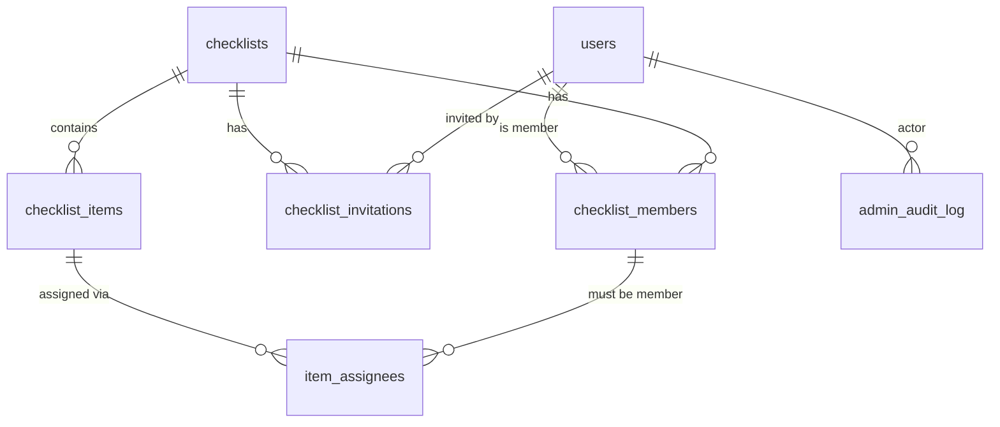

# MyCheckList Backend — Progress Log

> **This file is the main record of project progress.** Update it at the end of every work session: the status, the roadmap checkboxes and the session log.
> Shareable view (may lag behind this file): [Claude Doc](https://claude.ai/code/artifact/723d9711-56f2-47bb-8819-1605d8fa82c1)

Last updated: 2026-10-14

## Status

The authorization layer and checklists API are done. `./gradlew test` passes 14 of 14 tests on Jian's Mac.

- **Repo:** [github.com/munl/MyCheckList](https://github.com/munl/MyCheckList), branch `main`
- **Done:** database schema, Firebase sign-in, user records, the super admin role, Docker and Kubernetes setup
- **Firebase project ID:** `mychecklist-e745d` (the default in config)
- **Next:** Members and invitations API

## Decisions made

| Topic | Decision | Why |
| --- | --- | --- |
| Stack | Kotlin 2.2, Spring Boot 4.0.8, Java 21, Gradle 8.14 | Spring Boot 3.5 is past end of life; Kotlin matches Jian's Android background |
| Database | PostgreSQL, with the schema managed by Flyway migrations | Versioned SQL files; the app refuses to start if the code and the tables disagree |
| Auth | Firebase Google sign-in; the server checks the ID token against Google's public keys | No service account file needed |
| Hosting now | Local only: Docker Compose, or Kubernetes through Docker Desktop | Free and good for learning |
| Hosting later | Neon for Postgres; the app on a container host (Cloudflare Containers), or k3s on Oracle's free tier if Kubernetes should run online | Cloudflare doesn't run Kubernetes |
| Invites | By email, into an in-app inbox where users accept or decline; real emails are optional and later | So invites don't depend entirely on email |
| Assignment | Zero, one or many assignees per item; a list can be filtered by person | Works for both single-owner and shared tasks |
| Completion | V1 uses `ANY`: the first assignee to check an item off completes it for everyone | `EACH` (everyone checks off their own copy) can be added later |
| List roles | Owner (one per list), Editor, Viewer | |
| Super admin | `users.platform_role = SUPER_ADMIN`, set from the `APP_SUPER_ADMIN_EMAILS` setting; requires a verified email; changes are written to `admin_audit_log` | The role can't be granted through the API |
| Architecture | A modular monolith: one Spring Boot app and one database, with code grouped by feature (`user/`, `checklist/`, `admin/`) | The data is tightly linked, so splitting it into services gains nothing at this scale. To scale up, add replicas. A separate notifications worker is the first candidate to pull out later |
| Permissions | All checklist access goes through `ChecklistAccessService.requireAccess(...)`. Non-member: 404. Role too low: 403. Archived list: 409 on writes | One place to get right; IDs can't be probed |
| Errors | RFC 7807 `ProblemDetail` JSON. No stack traces, SQL or exception messages | Consistent for clients; doesn't leak internals |

## Data model

There are 7 tables. The database enforces the key rules itself, so a bug in the API can't break them. All IDs are UUIDs and all timestamps are `timestamptz`. The SQL is in `src/main/resources/db/migration/V1__initial_schema.sql`.



`item_assignees` also stores the item's `checklist_id`, with a foreign key to `checklist_members`. That stops anyone who isn't a member from being assigned, and removing a member unassigns them automatically.

| Rule | How it's enforced |
| --- | --- |
| One owner per list | Partial unique index on `checklist_members` where `role = 'OWNER'` |
| No duplicate pending invites | Partial unique index on (`checklist_id`, `invitee_email`) where `status = 'PENDING'` |
| Assignees must be list members | Composite foreign key from `item_assignees` to `checklist_members` |
| First person to complete an item wins | `UPDATE … WHERE completed_at IS NULL`; exactly one caller gets 1 row updated |
| No silent overwrites of items | `version` column (JPA `@Version`) |
| Emails are stored in lowercase | CHECK constraints on `users.email` and `invitee_email` |
| `updated_at` stays correct, even when rows are edited directly in SQL | Database triggers |
| V1 completion mode is `ANY` only | CHECK constraint; a later migration widens it to allow `EACH` |

## What's in the repo

The source code is under `src/main/kotlin/com/mychecklist/`.

| Path | What it does |
| --- | --- |
| `build.gradle.kts`, `settings.gradle.kts`, `gradlew` | Build setup: dependencies, the Kotlin and Spring plugins, the Java 21 toolchain |
| `resources/application.yml` | Settings: database URL, Firebase token checks, health endpoints. Each one can be overridden with an env var |
| `resources/db/migration/V1__initial_schema.sql` | Creates all 7 tables, constraints, indexes and `updated_at` triggers. Never edit it after it has run; add a `V2__…` file instead |
| `config/SecurityConfig.kt` | Every `/api/**` request needs a Firebase token; health checks are public; no server-side sessions |
| `config/AppProperties.kt` | Reads `app.firebase-project-id` and `app.super-admin-emails` |
| `user/User.kt`, `UserRepository.kt` | The `users` table and its queries, including a create-if-missing insert that's safe when two requests arrive at once |
| `user/UserService.kt` | Turns a verified token into a user row, and keeps the name, photo and super admin role in sync |
| `user/MeController.kt` | `GET /api/me` |
| `user/CurrentUser.kt` | `@CurrentUser user: User` controller parameter: the signed-in user's row, synced from the token |
| `common/ApiExceptions.kt`, `ApiExceptionHandler.kt` | `NotFound` / `Forbidden` / `Conflict` / `BadRequest` exceptions, turned into problem JSON |
| `checklist/ChecklistAccessService.kt` | **The permission check.** Every checklist, member, invite and item operation must call `requireAccess` |
| `checklist/ChecklistService.kt`, `ChecklistController.kt`, `ChecklistDtos.kt` | The checklists API |
| `admin/AdminAuditService.kt` | Writes `admin_audit_log` rows when a super admin changes someone else's data |
| `checklist/ChecklistEntities.kt` | Entities for checklists, members, invitations, items and assignees |
| `checklist/ChecklistRepositories.kt` | Database queries, including `completeIfOpen` (first one wins) and "my lists" |
| `admin/AdminController.kt`, `AdminAuditLog.kt` | `GET /api/admin/users` and the audit log entity |
| `src/test/.../SchemaAndUserSyncTest.kt` | Schema, user sync and "first one wins" tests |
| `src/test/.../ChecklistApiTest.kt` | API tests: owner, editor, viewer, outsider, super admin, archived lists, validation, 401 |
| `Dockerfile` | Two-stage build: compile with a JDK, then run on a slim JRE as a non-root user |
| `docker-compose.yml` | Local Postgres 17, plus the API in Docker if you want it |
| `k8s/` | Namespace, Postgres StatefulSet, API Deployment and NodePort service on port 30080; apply with `kubectl apply -k k8s/` |
| `docs/PROGRESS.md` | This file |
| `scripts/create-github-issues.sh` | Creates the V1 backlog as GitHub issues (`gh` CLI) |

**Endpoints so far**

| Endpoint | Who can call it |
| --- | --- |
| `GET /actuator/health` (plus `/liveness` and `/readiness`) | Anyone |
| `GET /api/me` | Any signed-in user; the first call creates their user row |
| `GET /api/admin/users` | Super admin only |
| `POST /api/checklists` | Any signed-in user (they become OWNER) |
| `GET /api/checklists` (`?archived=true`) | Any user; returns only lists they're a member of |
| `GET /api/checklists/{id}` | VIEWER or higher |
| `PATCH /api/checklists/{id}` | EDITOR or higher |
| `POST /api/checklists/{id}/archive` and `/unarchive` | OWNER |
| `DELETE /api/checklists/{id}?confirm=true` | OWNER |

## How to run it

Docker Desktop must be running for all of these. Kubernetes is only needed for the last one.

```bash
# Tests (Testcontainers starts a throwaway Postgres)
./gradlew test

# Day-to-day development
docker compose up -d db
export FIREBASE_PROJECT_ID=your-project-id
export APP_SUPER_ADMIN_EMAILS=you@gmail.com
./gradlew bootRun

# Everything in Docker
docker compose up --build

# Kubernetes (Docker Desktop > Settings > Kubernetes > Enable). Set the values in k8s/api.yaml first
docker build -t mychecklist-api:dev .
kubectl apply -k k8s/
curl http://localhost:30080/actuator/health
```

To call the API, get an ID token in the app with `Firebase.auth.currentUser?.getIdToken(false)`, then send it as `Authorization: Bearer <token>`.

**Firebase:** the project ID `mychecklist-e745d` is now the default, so there's no need to export `FIREBASE_PROJECT_ID` locally. Jian is setting up Google sign-in in that project.

## Roadmap

- [x] Plan the data model and roles
- [x] Scaffold the project: schema, auth, Docker, Kubernetes, tests
- [x] Push to GitHub
- [ ] Set up the Firebase project and test `/api/me` with a real token (in progress; project ID added to config)
- [x] **Authorization layer:** `ChecklistAccessService`, `@CurrentUser`, problem-detail errors, validation, admin audit
- [x] **Checklists API:** create, list mine, get, rename, archive, unarchive, delete
- [x] Run `./gradlew test`: 14 of 14 pass
- [ ] **Members and invites API:** invite by email, invite inbox, accept or decline, revoke, change role, remove member, leave a list
- [ ] **Items API:** add, edit, reorder, assign and unassign, complete and reopen, filter by assignee
- [ ] **Admin API:** edit or delete anything, with every change written to the audit log
- [ ] Generate API docs (OpenAPI/Swagger) for the mobile client
- [ ] Deploy online: Neon for the database, plus a container host

**Open questions**

- Should invites send a real email in V1, or only show up in the in-app inbox?
- Later: should items support `EACH` completion mode?
- Later: real-time updates (WebSockets or SSE), or does the app refresh when the user pulls down?

## Session log

| Date | What was done |
| --- | --- |
| 2026-10-14 (later) | Decided on a modular monolith and reviewed security. Added the authorization layer: one permission check, 404 for outsiders, 403 for low roles, archived lists read-only, super admin audited. Added problem-detail error handling, the `@CurrentUser` resolver and the checklists API, with 10 API tests and a role-order unit test; all 14 tests pass. Set the Firebase project ID (`mychecklist-e745d`). Wrote `scripts/create-github-issues.sh` (backlog; GitHub tickets are on hold for now) |
| 2026-10-14 | Planned the schema and roles, and added the super admin role. Scaffolded the Spring Boot project and checked the SQL constraints against Postgres 16. Installed Docker; `./gradlew test` passes 3 of 3. Pushed the initial commit to `munl/MyCheckList` on `main`. Added this progress file |
