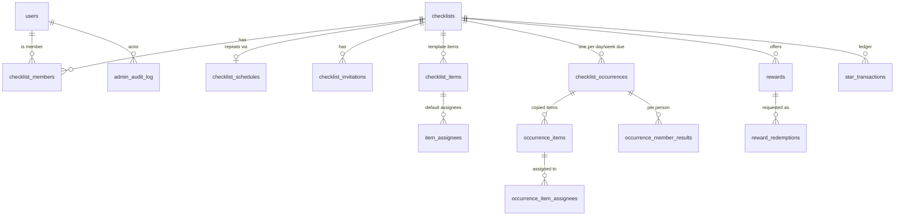

# MyCheckList Backend — Progress Log

> **This file is the main record of project progress.** Update it at the end of every work session: the status, the roadmap checkboxes and the session log.
> Shareable view (may lag behind this file): [Claude Doc](https://claude.ai/code/artifact/723d9711-56f2-47bb-8819-1605d8fa82c1)

Last updated: 2026-10-30

## Status

The database now supports **repeating lists, stars, streaks and rewards**. The schema is done, and the entities match it. The APIs for these features haven't been built yet.

The Members API has started: removed members now lose access (soft removal), `MemberService.addOrRestore` is the one way to add someone to a list, and `GET /api/checklists/{id}/members` lists a list's members (#6/#7, in review).

`./gradlew test` passes **43 of 43** (2026-10-30, fresh run, on branch `6-7-list-members`; not merged yet).

- **Repo:** [github.com/munl/MyCheckList](https://github.com/munl/MyCheckList), branch `main`
- **Firebase project ID:** `mychecklist-e745d` (the default in config)
- **Done:** database schema (including schedules, occurrences, stars and rewards), Firebase sign-in, user records, the super admin role, Docker and Kubernetes setup, the authorization layer, the checklists API, shared test helpers (#1), removed members lose access and rejoin with their stars (#2/#3)
- **Next:** the rest of the Members API (#4–#13, built test-first), then the Invitations API, then the Items and Occurrences API (which includes earning stars)

### Pick up here

1. Carry on with the **Members API**, one ticket pair at a time. Now: [#6](https://github.com/munl/MyCheckList/issues/6)/[#7](https://github.com/munl/MyCheckList/issues/7) (list members) on branch `6-7-list-members`: tests and build done, 43 of 43 pass; next is the PR and `/review-pr`. Then [#20](https://github.com/munl/MyCheckList/issues/20)/[#21](https://github.com/munl/MyCheckList/issues/21) (super admins can't be on lists), then #4/#5. The rules are in [Members API](#members-api) below. Each pair is a Tests ticket (written first) and a Build ticket, on one branch and one PR.
2. Build the **Invitations API**: invite by email (EDITOR+, and only the OWNER can invite editors), the inbox at `/api/me/invitations`, accept or decline, revoke, expiry. Responses must not reveal whether an email has an account. Follow the email privacy rules and "Repeat invites and reminders" in Decisions. Inbox only; no email sending in V1. Accepting must go through `MemberService.addOrRestore`, and fix [#17](https://github.com/munl/MyCheckList/issues/17) (two accepts at once) at the same time. An invite to a super admin's email is **quietly ignored**: the same response as any invite, nothing saved, nothing in their inbox (see "Super admins are never on lists" in Decisions).
3. Build the **Schedule, Items and Occurrences API**. See [Repeating lists](#repeating-lists) and [Stars and rewards](#stars-and-rewards) below for the rules. Assigning must follow the "Assigning" rule in Decisions.
4. Every endpoint goes through `ChecklistAccessService.requireAccess`, with tests for outsiders (404) and roles that are too low (403).
5. In parallel: finish Firebase Google sign-in and call `GET /api/me` with a real token from the Android app.

### How we work on a ticket

1. **Never commit straight to `main`.** Make one branch per ticket pair, with the issue numbers first: e.g. `12-13-transfer-ownership` for the tests ticket #12 and the build ticket #13.
2. Write the tests first, then the code, until `./gradlew test` passes in full.
3. Open a PR (put `Closes #12, closes #13` in the description: GitHub needs the keyword before **each** number, or only the first issue closes). GitHub Actions runs the whole test suite on it (`.github/workflows/tests.yml`, the **Tests** check); it must pass before the PR can be merged.
4. Run **`/review-pr`** (the skill is in `.claude/skills/review-pr/SKILL.md`). A separate reviewer agent lists the risks: anything that could break behaviour, open a security hole or lose data. No style nitpicks. It skips risks that another open ticket already plans, decisions recorded below, and things already raised on the PR.
5. Reply with a choice for each risk, e.g. `fix 1,3 · backlog 2 · drop 4 (fine for MVP) · discuss 5`. Then:
   - each risk gets its own thread on the PR (Jian previews the text first)
   - fixes are done test-first, one commit each, and pushed after Jian's OK
   - backlog items become single GitHub issues labelled `backlog`, on the project board
   - drops can be recorded in Decisions
6. Each thread gets a reply with the outcome (commit, issue link or reason) and is then resolved. **No open threads = review done.** Re-run `/review-pr` for a full re-review.

### About the database and migrations

No real database has been created yet. `./gradlew test` uses a temporary Postgres that Testcontainers deletes after each run. That's why the new tables were written straight into `V1__initial_schema.sql` instead of a `V2` migration.

**From the first time the app runs against a database we keep** (local `docker compose`, Kubernetes or Neon), V1 is frozen and every change goes in `V2__…`, `V3__…`. To wipe a local database and start fresh: `docker compose down -v` (the `-v` deletes the data volume), or `kubectl delete -k k8s/` for Kubernetes.

## Decisions made

| Topic | Decision | Why |
| --- | --- | --- |
| Stack | Kotlin 2.2, Spring Boot 4.0.8, Java 21, Gradle 8.14 | Spring Boot 3.5 is past end of life; Kotlin matches Jian's Android background |
| Architecture | A modular monolith: one Spring Boot app and one database. Code is organized **by feature** (`user/`, `checklist/`, `occurrence/`, `stars/`, `reward/`...), each with `api/`, `domain/` and `data/` subfolders, following the Spring Boot docs' recommended layout | The data is tightly linked, so splitting it into services gains nothing at this scale. To scale, add replicas. A notifications worker is the first candidate to split out later |
| Database | PostgreSQL, with the schema managed by Flyway migrations | Versioned SQL files; the app refuses to start if the code and tables disagree |
| Auth | Firebase Google sign-in; the server checks the ID token against Google's public keys | No service account file needed |
| Permissions | All checklist access goes through `ChecklistAccessService.requireAccess(...)`. Non-member: 404. Role too low: 403. Archived list: 409 on writes | One place to get right; IDs can't be probed |
| Errors | RFC 7807 `ProblemDetail` JSON. No stack traces, SQL or exception messages | Consistent for clients; doesn't leak internals |
| Hosting now | Local only: Docker Compose, or Kubernetes through Docker Desktop | Free, good for learning |
| Hosting later | Neon for Postgres; the app on a container host (Cloudflare Containers), or k3s on Oracle's free tier for Kubernetes online | Cloudflare doesn't run Kubernetes |
| List roles | Owner (one per list), Editor, Viewer | |
| Super admin | `users.platform_role = SUPER_ADMIN`, set from the `APP_SUPER_ADMIN_EMAILS` setting; requires a verified email; changes go to `admin_audit_log` | The role can't be granted through the API |
| Super admins are never on lists | Super admins are **separate accounts** with their own emails, made for overseers who will use a **web dashboard (planned for later)** to see and change anything, audited. They are never members of a list: creating a list → 403, `MemberService.addOrRestore` → 403, and an invite to their email is quietly ignored (same response, nothing saved). If an email is added to `APP_SUPER_ADMIN_EMAILS` while that person is still on a list, they stay `USER` at sign-in (a warning is logged with the email masked) until they've left every list. Tickets #20/#21 (decided 2026-10-30) | They're auditors, not list users, so a role on a list would mix the two. Quietly ignoring invites keeps the email privacy rule: nobody learns who the admins are |
| Invites | By email, into an in-app inbox to accept or decline. **V1 ships with the inbox only.** Invite emails are a nice-to-have for later and will use **Resend** (free tier: 3,000 a month, 100 a day; Brevo, at 300 a day, is the fallback). The invite code is built so email can be added without changing the API: the invite and a "send email" job are saved in one transaction, and a background job sends the email and retries. A failed or skipped email never breaks the invite | So invites don't depend on email; sending needs our own domain (~$10–15 a year) for SPF/DKIM |
| Repeat invites and reminders | If someone already has a **pending** invite to a list, a new invite to them is **ignored**: no second invite, nothing sent. The owner can send a **reminder** to a pending invitee, which sends a new email (comes with invite emails, after V1). Joining a list you're already an active member of changes nothing (`MemberService.addOrRestore` leaves the row as it is) | Avoids duplicate invites and spam; reminders are a deliberate owner action (decided 2026-10-23) |
| Email privacy | Show emails only where needed (members list: names, and emails to owners at most). Never log email addresses (mask them, e.g. `j***@gmail.com`). Invite responses never reveal whether an account exists. Clear the email from declined, revoked and expired invites after ~30 days. When email sending arrives: one recipient per message, no free-form inviter text, rate limits on invites, an opt-out, and the API key kept in env vars or a Kubernetes Secret. No column-level encryption in V1 | Covers the realistic ways addresses leak. Encryption would need a blind-index lookup column and key management, and Firebase already holds the same addresses |
| SQL injection | Every query uses bound parameters: Spring Data derived queries, or `@Query` with `:named` params. **Never build SQL or JPQL by joining or interpolating strings**, including for sorting and filtering (use an allowlist of column names). All input is validated with Bean Validation (`@Email`, `@Size`...) before it reaches a service | Checked 2026-10-21: all 8 custom queries are parameterized |
| Code review | Every change goes on a branch and a PR. `/review-pr` finds risks; Jian decides fix / backlog / drop / discuss for each. One resolved PR thread per risk, with a "Review drafted with Claude Code" footer. Only open tickets count as "already planned" | Catches real breakage without nitpicks, keeps a record on the PR, and stops review findings from getting lost or duplicating planned tickets |
| Assignment | Zero, one or many assignees per item; a list can be filtered by person | Works for both single-owner and shared tasks |
| Completion | "First one wins": the first tick completes the item for everyone. **Helping counts**, so if someone else ticks your item, it counts for you | Encourages helping each other |
| Repeating lists | Every list is a **template**; each day or week it's due gets its own **occurrence** (a fresh copy). A one-time list has exactly one occurrence | One model for both kinds of list, with full history |
| Repeat options | Daily, weekly, monthly, every N days/weeks/months, chosen weekdays (e.g. Mon, Wed, Sat), monthly on a date or on the "Nth/last weekday"; can end on a date or after N times | Covers the custom options asked for |
| Day boundary | Midnight in the **list's own time zone** (set by the owner, defaulting to their phone's zone) | Everyone on a list shares one "today" |
| Template edits | Apply from the **next** occurrence; today's copy doesn't change | Stops anyone removing undone items to fake completion |
| Past days | **Closed at midnight.** Items from previous days can't be ticked | Streaks can't be patched later |
| Stars | Only on **repeating** lists. You earn them when **all items assigned to you** in an occurrence are done | Fair when work is split |
| No items that day | The day is **skipped**: no star, and the streak isn't broken | |
| Star timing | Awarded **instantly** when your last item is ticked. Taken back if an item is unticked before midnight. **Settled at midnight** | Instant reward feeling, and the final result is correct |
| Compounding | Streak tiers with a cap, for you and for the team (table below). Tiers live in config so they can be tuned. **Global only; owners can't change them per list** (decided 2026-10-21) | Owners already control what each reward costs, which does the same job. Per-list tiers can come later in a migration without breaking anything |
| Reward cost suggestions | The client app suggests star costs by reward size (e.g. small, medium, large) when creating a reward. The owner can always enter any cost from 1 to 100,000. The server may expose the tiers (e.g. `GET /api/config/stars`) so the app's suggestions follow the tiers if they're tuned | Helps owners pick fair costs without needing per-list tiers |
| Team bonus | When **everyone** with items finishes, each of them gets a bonus that grows with the team streak and has a cap | Rewards working together |
| Non-daily lists | One star "unit" per occurrence (a weekly list counts streaks in weeks) | |
| Rewards | Per list. Owners **and editors** create, edit and remove them, and can change the star cost at any time. Redemptions are unlimited | |
| Redeeming | A member requests it, stars are **held** straight away, and an owner or editor approves (stars spent) or rejects (stars refunded). **You can't approve your own request** unless you're the only owner or editor | Prevents spending the same stars twice, and self-approval |
| Adjustments | Owners and editors can add or remove stars by hand, **with a reason**; every change is in the star ledger | Balances can always be explained |
| Storage growth | Grows **linearly**: about 0.5 KB per item per day it's due, so a 10-item daily list is about 2 MB a year. Kept in check three ways (below) | Neon's free plan has 1 GB per project; that lasts years at family scale, about 1 year at 1,000 active users |
| Lazy occurrences | A day's copy is created **only when someone opens or ticks the list**. A due day with no copy counts as missed, worked out from the schedule | Abandoned lists cost no storage |
| History compaction | After **90 days** (`app.history.full-detail-days`), a nightly job deletes that day's item copies but keeps the per-person results, the list totals (`item_count`, `completed_item_count`) and the star ledger | Cuts history storage by ~90%. The 90 days can be raised later |
| Auto-pause | Repeating lists that nobody has opened for **14 days** (`app.schedule.auto-pause-after-days`) are paused: no new days, and missed days don't break streaks. Opening the list resumes it | No growth from lists people stopped using |
| Push notifications | **Firebase Cloud Messaging** (free, no message limits). The server sends through the Firebase Admin SDK, which needs a service account key kept in an env var or Kubernetes Secret, never in git. New tables: `device_tokens` (registered after sign-in, deleted on sign-out or when FCM rejects them, stored with the phone's time zone) and per-person notification preferences. Notification text has no email addresses or item details (lock screens are visible). Every type can be turned off | FCM is already part of the Firebase project |
| Streak-at-risk reminder (V1) | Sent **3 hours before the list's deadline** (midnight in the **list's** time zone, so 9 pm list time; `app.notifications.streak-reminder-hours-before=3`). Goes only to members with unfinished items assigned to them in today's occurrence, on repeating lists that aren't paused. **Quiet hours:** skipped if it would land between 10 pm and 8 am in the *person's own* time zone (from their device). At most one per person per list per day | Timing from the list's deadline is correct for every member wherever they are; quiet hours stop a member in a different zone from being woken up |
| Building features | **Test-first (TDD).** Agree the rules by questions, write the tests from them as their own ticket (merged with `@Disabled("Waiting on #N")` so `main` stays green), then a Build ticket switches them on and writes the code. A test is only changed after checking the rule with Jian. Small tickets and small PRs, one piece at a time | So tests check the agreed rules, not whatever the code happens to do |
| Removing members | **Soft removal:** leaving or being removed sets `checklist_members.removed_at`; the row is kept. They lose access at once (404, like an outsider). They're unassigned from the template and today's open copy (closed days untouched), and pending reward requests are cancelled and refunded. Stars they already earned today are kept, and aren't taken back at midnight. A rejoin restores the same row with their old stars and streaks, and a **new join date** | Keeps star history and past days complete, and the cached balance consistent with the ledger |
| Assigning | **Only active members can be assigned** to an item. Any code that assigns people, or copies a template's assignees into a new day's copy, must check `removed_at IS NULL` (for example with `findByIdAndRemovedAtIsNull`) | The database link to `checklist_members` can't do it: removed members keep their row (found in review, PR #16) |
| Join date on rejoin | A rejoin resets `joined_at` to the rejoin time, so the members list shows and sorts by when they came back. The column stays `updatable = false` on the entity; only `ChecklistMemberRepository.restoreRemoved` (used by `addOrRestore`) changes it. The first join date isn't kept: **if a feature ever needs it, add a separate first-joined column before going live** (decided 2026-10-30, PR #22 review) | To other members, someone who comes back is joining again. Nothing else uses the date, and there's no real data to lose yet |
| Ownership | Transfer to any active member, immediately, no accept step; the old owner becomes an editor. The owner can't leave or be removed until they transfer. Only the owner changes roles or removes members. **A transfer to someone who already owns the maximum (200) lists is refused with 409** (decided 2026-10-23) | A list always has exactly one owner |
| Other notifications (later) | Invite received; reward request (to owners and editors); request approved or rejected; team finished (everyone gets the bonus) | Agreed as good ideas, not in V1 |

## Data model

There are 15 tables. The database enforces the key rules itself, so a bug in the API can't break them. All IDs are UUIDs and all timestamps are `timestamptz`. The SQL is in `src/main/resources/db/migration/V1__initial_schema.sql`.



| Table | Purpose |
| --- | --- |
| `users` | One row per person, created on first sign-in. `platform_role` is `USER` or `SUPER_ADMIN` |
| `checklists` | A list. `time_zone`, team streak, `archived_at` (soft delete) |
| `checklist_schedules` | How a list repeats. **No row = a one-time list** |
| `checklist_members` | Who's in a list, their role, plus cached `star_balance`, `current_streak`, `longest_streak` |
| `checklist_invitations` | The invite inbox, matched by email |
| `checklist_items`, `item_assignees` | The **template**: items and their default assignees |
| `checklist_occurrences` | One per date the list is due: `occurrence_date`, `due_at`, `status` (`OPEN`/`CLOSED`) |
| `occurrence_items`, `occurrence_item_assignees` | That occurrence's copy of the items; ticking happens here |
| `occurrence_member_results` | How each person did: items assigned and done, stars awarded, streak after |
| `rewards` | Title, description, star cost, active flag, soft delete |
| `reward_redemptions` | Requests to spend stars: `PENDING` → `APPROVED` / `REJECTED` / `CANCELLED`. The cost is copied at request time |
| `star_transactions` | **The ledger**: every star earned, spent, refunded or adjusted |
| `admin_audit_log` | Changes a super admin made to other people's data |

| Rule | How it's enforced |
| --- | --- |
| One owner per list | Partial unique index on `checklist_members` where `role = 'OWNER'` |
| No duplicate pending invites | Partial unique index on (`checklist_id`, `invitee_email`) where `status = 'PENDING'` |
| Assignees must be list members | Composite foreign keys from both assignee tables to `checklist_members`; removing a member unassigns them |
| One occurrence per list per date | Unique (`checklist_id`, `occurrence_date`) |
| Schedules are valid | CHECKs: weekly needs at least one weekday; monthly uses a date **or** an "Nth weekday", never both; `ends_on` ≥ `starts_on` |
| First person to complete an item wins | `UPDATE … WHERE completed_at IS NULL`; exactly one caller gets 1 row updated |
| No silent overwrites | `version` column on occurrence items (JPA `@Version`) |
| Stars awarded at most once per person per occurrence | Partial unique index on `star_transactions` (occurrence, user, type) for rows that aren't voided |
| A redemption is charged once and refunded at most once | Unique (`redemption_id`, `type`) |
| Balances never go negative | `CHECK (star_balance >= 0)` |
| Adjustments have a reason and an author | CHECK on `star_transactions` |
| Reward costs are 1–100,000 stars | CHECK |
| Emails are lowercase | CHECK constraints on `users.email` and `checklist_invitations.invitee_email` |
| `updated_at` stays correct, even for edits made directly in SQL | Database triggers |

## Members API

Planned 2026-10-22 as [GitHub issues #1–#13](https://github.com/munl/MyCheckList/issues) (milestone "V1 API"), built in this order:

| # | Ticket |
| --- | --- |
| [#1](https://github.com/munl/MyCheckList/issues/1) | Setup: move shared test helpers into `support/` |
| [#2](https://github.com/munl/MyCheckList/issues/2) / [#3](https://github.com/munl/MyCheckList/issues/3) | Removed members lose access (`removed_at`): tests / build |
| [#6](https://github.com/munl/MyCheckList/issues/6) / [#7](https://github.com/munl/MyCheckList/issues/7) | List members: tests / build |
| [#20](https://github.com/munl/MyCheckList/issues/20) / [#21](https://github.com/munl/MyCheckList/issues/21) | Super admins can't be on lists: tests / build (added 2026-10-30) |
| [#4](https://github.com/munl/MyCheckList/issues/4) / [#5](https://github.com/munl/MyCheckList/issues/5) | Change a member's role: tests / build |
| [#8](https://github.com/munl/MyCheckList/issues/8) / [#9](https://github.com/munl/MyCheckList/issues/9) | Remove a member, and leave: tests / build |
| [#10](https://github.com/munl/MyCheckList/issues/10) / [#11](https://github.com/munl/MyCheckList/issues/11) | Clean-up when a member is removed: tests / build |
| [#12](https://github.com/munl/MyCheckList/issues/12) / [#13](https://github.com/munl/MyCheckList/issues/13) | Transfer ownership: tests / build |

| Endpoint | Who | Notes |
| --- | --- | --- |
| `GET /api/checklists/{id}/members` | VIEWER+ | Active members: `userId`, `displayName`, `photoUrl`, `role`, `joinedAt`, `starBalance`, `currentStreak`, `longestStreak` (a missing name or photo is `null`). The owner first, then by join date, ties by `userId`. Emails only for the owner and super admin; editors and viewers get no `email` key at all. A super admin reading it isn't audited |
| `PATCH /api/checklists/{id}/members/{userId}` | OWNER | `{role}`: EDITOR or VIEWER only (OWNER → 400). Can't change the owner (409) |
| `DELETE /api/checklists/{id}/members/{userId}` | OWNER | Soft removal plus clean-up. Can't remove the owner (409) |
| `POST /api/checklists/{id}/leave` | EDITOR, VIEWER | Works on archived lists. The owner gets 409 ("transfer ownership first") |
| `POST /api/checklists/{id}/transfer-ownership` | OWNER | `{userId}` of any active member; the old owner becomes EDITOR |

On archived lists only viewing and leaving work; other member changes return 409. That includes joining: `MemberService.addOrRestore` gives 409 on an archived list (for everyone, super admins included; unarchive first) and 404 if the list doesn't exist. A super admin can do everything, audited. Stars a removed member already earned today are kept (confirmed 2026-10-23).

## Repeating lists

`checklist_schedules` stores a subset of the calendar-standard repeat rule (RFC 5545):

| Example | `frequency` | Other fields |
| --- | --- | --- |
| Every day | `DAILY` | `repeat_interval = 1` |
| Every 3 days | `DAILY` | `repeat_interval = 3` |
| Mon, Wed, Sat | `WEEKLY` | `weekday_mask = 37` (Mon 1 + Wed 4 + Sat 32) |
| Every other Friday | `WEEKLY` | `repeat_interval = 2`, `weekday_mask = 16` |
| 15th of each month | `MONTHLY` | `month_day = 15` |
| Last Friday of the month | `MONTHLY` | `month_week = -1`, `month_weekday = 5` |
| …for 12 times / until a date | any | `max_occurrences = 12` / `ends_on` |

The weekday bits are Mon=1, Tue=2, Wed=4, Thu=8, Fri=16, Sat=32, Sun=64. In Kotlin, use `ChecklistSchedule.maskOf(MONDAY, WEDNESDAY, SATURDAY)`.

**Lifecycle of an occurrence**

1. **Created lazily**, the first time someone opens or ticks the list on a due day. Items and assignees are copied from the template. No one opens it means no row; the day still counts as missed for streaks.
2. **Open:** items are ticked. Stars are awarded instantly when a person's last item is done, and voided if an item is unticked.
3. **Closed** at `due_at` (the next midnight in the list's zone) by a scheduled job, which settles the results:
   - Each person who finished: their streak goes up by 1.
   - Each person with items who didn't finish: their streak resets to 0.
   - People with no items: no change.
   - Team streak: +1 if everyone with items finished, otherwise reset to 0.
4. Closed occurrences are read-only history.
5. **Compacted** after 90 days: the item copies are deleted and `compacted_at` is set. The occurrence row (with `item_count` and `completed_item_count`), the member results and the star ledger stay.

Opening a list or ticking an item updates `checklists.last_activity_at`. If a repeating list has had no activity for 14 days, `checklist_schedules.paused_at` is set and no occurrences are created until someone opens it again.

## Stars and rewards

**Stars per occurrence** (tiers kept in config so they can be tuned):

| Streak (consecutive completed occurrences, including this one) | Your stars | Team bonus (each member who had items) |
| --- | --- | --- |
| 1–6 | 1★ | +1★ |
| 7–13 | 2★ | +2★ |
| 14–29 | 3★ | +3★ (cap) |
| 30+ | 4★ (cap) | +3★ |

The most anyone can earn per occurrence is 7★. Example: on day 10 of your streak and day 8 of the team's, you get 2★ + 2★ = 4★.

**Balance:** the ledger (`star_transactions`) is the source of truth. `checklist_members.star_balance` is a cached sum, updated in the same transaction as each ledger row.

| Ledger `type` | `amount` | When |
| --- | --- | --- |
| `DAILY_COMPLETION` | +1 to +4 | Your last item is done. Voided if an item is unticked before midnight |
| `TEAM_BONUS` | +1 to +3 | The whole team finished |
| `ADJUSTMENT` | ± | An owner or editor adds or removes stars, with a reason |
| `REDEMPTION` | − cost | A reward is requested (the stars are held) |
| `REDEMPTION_REFUND` | + cost | The request is rejected or cancelled |

**Redemption flow:** request (needs `star_balance` ≥ cost; stars are held) → an owner or editor who isn't the requester approves (stays spent) or rejects (refunded). The requester can cancel while it's pending (refunded). If there's only one owner or editor on the list, they can approve their own request.

## What's in the repo

The source code is under `src/main/kotlin/com/mychecklist/`, organized **by feature**. Every feature has the same `api/` (controllers + DTOs), `domain/` (entities, one per file) and `data/` (repositories) folders, with its service at the feature root. The README has the full tree and rules.

| Path | What it does |
| --- | --- |
| `build.gradle.kts`, `settings.gradle.kts`, `gradlew` | Build setup: dependencies, the Kotlin and Spring plugins, the Java 21 toolchain |
| `resources/application.yml` | Settings: database URL, Firebase token checks, health endpoints. Each can be overridden with an env var |
| `resources/db/migration/V1__initial_schema.sql` | All 15 tables, constraints, indexes and `updated_at` triggers |
| `config/` | `SecurityConfig` (every `/api/**` request needs a Firebase token), `AppProperties`, `WebConfig` |
| `common/error/` | `NotFound` / `Forbidden` / `Conflict` / `BadRequest` exceptions, turned into problem JSON |
| `user/` | `UserService` (token → user row), `@CurrentUser`; `api/` `GET /api/me`; `domain/` `User`; `data/` `UserRepository` |
| `checklist/` | `ChecklistAccessService` (**the permission check**: every checklist, member, invite, item and reward operation must call `requireAccess`), `ChecklistService`; `api/` controller and DTOs; `domain/` `Checklist`, `ChecklistMember` (with star and streak totals and `removedAt`), `MemberRole`; `data/` `ChecklistMemberRepository`. The member entity stays here because the permission check relies on it |
| `member/` | `MemberService` (`addOrRestore`: **the only way to add someone to a list**; restores a removed member's row). `list` (the members endpoint, two queries however many members). `api/` `MemberController`, `MemberDtos` (decided 2026-10-30) |
| `invitation/`, `item/`, `schedule/` | Entities and repositories for invitations, template items and assignees, and repeat rules |
| `occurrence/` | Occurrences, their item copies and assignees, member results; `OccurrenceItemRepository.completeIfOpen` (first one wins) |
| `stars/`, `reward/` | The star ledger; rewards and redemptions |
| `admin/` | `AdminAuditService` (audit rows), `GET /api/admin/users` |
| `src/test/.../SchemaAndUserSyncTest.kt` | Schema, user sync, "first one wins" with a helper, schedule weekdays, award-once tests |
| `src/test/.../checklist/ChecklistApiTest.kt` | API tests: each role, super admin, archived lists, validation, time zones, 401 |
| `src/test/.../checklist/RemovedMemberAccessTest.kt` | Removed members: 404 on reads and writes, gone from their lists (active and archived), not in `memberCount`, one-owner index and owned-lists limit |
| `src/test/.../member/MemberRejoinTest.kt` | `addOrRestore`: rejoin keeps stars, active members unchanged, no OWNER, archived (409) and missing (404) lists |
| `src/test/.../member/ListMembersTest.kt` | `GET /api/checklists/{id}/members` (#6): fields, order, removed members, emails by role, archived lists, 404s, super admin |
| `src/test/.../support/` | `TestcontainersConfig` (shared throwaway Postgres), `TestUsers.kt` (`signedIn`, `superAdmin`), `TestChecklists` (`createList`, `addMember`, `userId`, `insertOwnerRow`) |
| `Dockerfile`, `docker-compose.yml`, `k8s/` | Container image, local Postgres 17, Kubernetes manifests |
| `.claude/skills/review-pr/SKILL.md` | The `/review-pr` skill: the risk review on an open PR (see [How we work on a ticket](#how-we-work-on-a-ticket)) |
| `scripts/create-github-issues.sh` | Creates the V1 backlog as GitHub issues (`gh` CLI). Tickets are on hold for now |

**Endpoints so far**

| Endpoint | Who can call it |
| --- | --- |
| `GET /actuator/health` (plus `/liveness` and `/readiness`) | Anyone |
| `GET /api/me` | Any signed-in user; the first call creates their user row |
| `GET /api/admin/users` | Super admin only |
| `POST /api/checklists` | Any signed-in user (they become OWNER). Body: `title`, `description?`, `timeZone?` |
| `GET /api/checklists` (`?archived=true`) | Any user; returns only lists they're a member of |
| `GET /api/checklists/{id}` | VIEWER or higher |
| `PATCH /api/checklists/{id}` | EDITOR or higher (`title`, `description`, `timeZone`) |
| `POST /api/checklists/{id}/archive` and `/unarchive` | OWNER |
| `DELETE /api/checklists/{id}?confirm=true` | OWNER |
| `GET /api/checklists/{id}/members` | VIEWER or higher. Emails only for the owner and super admins |

## How to run it

Docker Desktop must be running for all of these. Kubernetes is only needed for the last one.

```bash
# Tests (Testcontainers starts a throwaway Postgres, then deletes it)
./gradlew test

# Day-to-day development
docker compose up -d db
export APP_SUPER_ADMIN_EMAILS=you@gmail.com   # optional
./gradlew bootRun

# Everything in Docker
docker compose up --build

# Kubernetes (Docker Desktop > Settings > Kubernetes > Enable). Set APP_SUPER_ADMIN_EMAILS in k8s/api.yaml first
docker build -t mychecklist-api:dev .
kubectl apply -k k8s/
curl http://localhost:30080/actuator/health

# Wipe local data and start fresh
docker compose down -v        # or: kubectl delete -k k8s/
```

To call the API, get an ID token in the app with `Firebase.auth.currentUser?.getIdToken(false)`, then send it as `Authorization: Bearer <token>`.

## Roadmap

- [x] Plan the data model and roles
- [x] Scaffold the project: schema, auth, Docker, Kubernetes, tests
- [x] Push to GitHub
- [x] **Authorization layer:** `ChecklistAccessService`, `@CurrentUser`, problem-detail errors, validation, admin audit
- [x] **Checklists API:** create, list mine, get, rename, archive, unarchive, delete (14 tests passed)
- [x] **Schema for repeating lists, stars and rewards** (schedules, occurrences, results, ledger, rewards, redemptions) and its entities
- [x] Run `./gradlew test` on the new schema: 16 of 16 pass
- [x] Reorganize the code into feature packages (`api/`, `domain/`, `data/`); 16 of 16 tests pass
- [ ] Set up Firebase Google sign-in and test `/api/me` with a real token (in progress)
- [x] Plan the Members API and create its tickets (#1–#13)
- [ ] **Members API:** list, change role, remove, leave, transfer ownership (#1–#13). Done: #1 (PR #14), #2/#3 (PR #16). #6/#7 built (PR pending). Added #20/#21 (super admins can't be on lists)
- [ ] **Invitations API:** invite by email, inbox, accept or decline, revoke
- [ ] **Schedule API:** set, change or remove a list's repeat rule, and preview its next dates
- [ ] **Items and Occurrences API:** template items (add, edit, reorder, assign); today's occurrence (get or create, tick and untick, "my items" and "unassigned" filters); history
- [ ] **Stars engine:** instant awards and voids, streak and team-bonus tiers from config, a midnight job that closes occurrences and settles streaks (including due days with no occurrence = missed, and paused days = skipped)
- [ ] **Housekeeping jobs:** nightly compaction of occurrences older than 90 days; auto-pause repeating lists inactive for 14 days
- [ ] **Rewards API:** create, edit, change cost, deactivate, delete; request, approve, reject, cancel redemptions; manual adjustments; star history
- [ ] **Admin API:** edit or delete anything, with every change written to the audit log
- [ ] **Push notifications (V1):** FCM setup (service account as a secret), device token register and unregister, notification preferences, the streak-at-risk job (3 hours before the list's deadline, quiet hours in the person's zone, once per day)
- [ ] Later notifications: invite received, reward request, request approved or rejected, team finished
- [ ] Later: invite emails through Resend (needs our own domain)
- [x] Code review workflow: the `/review-pr` skill
- [ ] CI (GitHub Actions) and Dependabot. CI done: the **Tests** check runs on every PR and push to `main`, and must pass before merging (PR #19)
- [ ] API docs (OpenAPI/Swagger) for the mobile client
- [ ] Security hardening, then deploy online: Neon plus a container host

**Open questions**

- ~~Should invites send a real email in V1?~~ Decided 2026-10-21: inbox only in V1, Resend email later (see Decisions)
- ~~Should star tiers be configurable per list?~~ Decided 2026-10-21: global only; the app suggests reward costs by size
- ~~Notifications: push "your streak is at risk" reminders?~~ Decided 2026-10-21: yes in V1, using FCM, 3 hours before the list's deadline; other notifications later
- Later: should items support an `EACH` completion mode, where every assignee ticks their own copy?
- Later: real-time updates (WebSockets or SSE), or does the app refresh when the user pulls down?

## Session log

| Date | What was done |
| --- | --- |
| 2026-10-30 | Started #6/#7 (list members) on branch `6-7-list-members`; kept the planned order (#6/#7 before #4/#5). Agreed the details: the owner first, then by join date, ties by `userId`; editors and viewers get no `email` key at all; `photoUrl` included; a missing name or photo is `null`; a super admin reading it isn't audited. Wrote 14 tests in `ListMembersTest` (switched off with `@Disabled("Waiting on #7")`), checked that all 14 fail when switched on, and made the 404 tests check "Checklist not found" so a missing route can't pass them. Added an optional `picture` to the `signedIn` test helper. Moved `MemberService` and the member tests to a new `member/` package; the member entity, repository and `MemberRole` stay in `checklist/`. Decided that super admins are separate overseer accounts for a future web dashboard and are never on lists, and created #20/#21 for it. Updated issue #6 with the agreed rules. Built #7: `MemberService.list` and `MemberController` (`GET /api/checklists/{id}/members`), loading members and their users in two queries. One run failed to connect to the test database (an SSL error from the Postgres container, not the code); two full reruns passed. 43 of 43 tests pass |
| 2026-10-23 (later) | Confirmed the last open #10 rule: stars a removed member already earned today are kept. Updated issue #10. Merged #1 (shared test helpers in `support/`, PR #14). Built #2/#3 (removed members lose access) on one branch: `removed_at`, a one-owner index that ignores removed members, and every member query skipping them. Removed members also don't count in `memberCount` (new rule on #2). Added a test that the owned-lists limit ignores removed owner rows. Decided that a transfer to someone at the 200-list limit gets 409, and added that rule to #12/#13. Opened PR #16 for #2/#3 and ran `/review-pr` three times (a full review, a short re-review of the fixes, then a full re-review): 8 risks in total, 7 fixed and 1 backlogged as #17. The fixes added `MemberService.addOrRestore` (restores a removed member's row with their stars and streaks; leaves active members as they are; refuses OWNER; 409 on archived lists, 404 on missing ones) and an "Assigning" rule. Recorded the repeat-invite and reminder decisions. 29 of 29 tests pass. Merged PR #16; #3 had to be closed by hand because the PR said `Closes #2, #3`, so the workflow now says `Closes #12, closes #13` |
| 2026-10-23 | Designed and added the `/review-pr` skill with Jian (committed on `main` as an agreed exception). Agreed the workflow: never commit to `main`; one branch and PR per ticket pair; a separate reviewer agent reports every high risk plus medium ones up to 6, each with where, why, a failure scenario, a suggested fix and what else it affects; it skips what open tickets, recorded decisions or earlier PR threads already cover. Decisions are posted as one inline PR thread per risk, then each thread is answered and resolved. Backlog items become `backlog` issues on the board |
| 2026-10-22 | Planned the Members API test-first. Decided: soft removal (`removed_at`) with clean-up, transfer to any member with the old owner becoming an editor, the owner must transfer before leaving, the members list shows stars to everyone and emails to the owner only, and only leaving works on archived lists. Created GitHub issues #1–#13 as test/build pairs, with labels and the "V1 API" milestone |
| 2026-10-21 | Worked through the open questions. Invites: inbox only in V1, Resend email as a later nice-to-have, plus email privacy rules. Confirmed that all custom queries use bound parameters and recorded a "no string-built SQL" rule. Ran `./gradlew test` after the reorganization and storage controls: 16 of 16 pass. Star tiers stay global; the client app will suggest reward costs by size. Push notifications through FCM: the streak-at-risk reminder is in V1 (3 hours before the list's deadline, quiet hours in each person's own zone); invite, reward-request, approval and team-finished notifications are recorded for later |
| 2026-10-15 (evening) | Reviewed storage growth (it's linear, about 2 MB per year for a 10-item daily list). Agreed on three ways to keep it down: lazy occurrences, compacting history after 90 days, and auto-pausing lists after 14 days without activity. Schema: `checklists.last_activity_at`, `checklist_schedules.paused_at`, and `item_count`, `completed_item_count` and `compacted_at` on occurrences. Config: `app.history.full-detail-days=90`, `app.schedule.auto-pause-after-days=14`. V1 was edited in place again, since there's still no persistent database |
| 2026-10-15 (later) | Confirmed the new schema: 16 of 16 tests pass. Reorganized the code by feature, with `api/`, `domain/` and `data/` subfolders and one entity per file (25 files became 57; no logic changed). Moved the Testcontainers setup to `src/test/.../support/` |
| 2026-10-15 | Designed repeating lists, stars, streaks, a team bonus and rewards with Jian. Every list became a template plus per-period occurrences, with a schedule table following RFC 5545. Added a star ledger, cached balances and streaks, rewards and redemptions (stars held, owners or editors approve, no self-approval). Rewrote V1 in place, since no real database exists yet. Checked every new constraint against Postgres 16. Updated the entities and tests (16 total, not yet run). Removed `completion_mode` (it may come back as `EACH` in a later migration). The checklist response now has `timeZone` and no longer has `completedItemCount` |
| 2026-10-14 (later) | Decided on a modular monolith and reviewed security. Added the authorization layer, problem-detail errors, `@CurrentUser` and the checklists API; 14 of 14 tests pass. Set the Firebase project ID. Wrote `scripts/create-github-issues.sh` |
| 2026-10-14 | Planned the schema and roles, and added the super admin role. Scaffolded the Spring Boot project. Installed Docker; `./gradlew test` passes 3 of 3. Pushed to `munl/MyCheckList` on `main`. Added this progress file |
